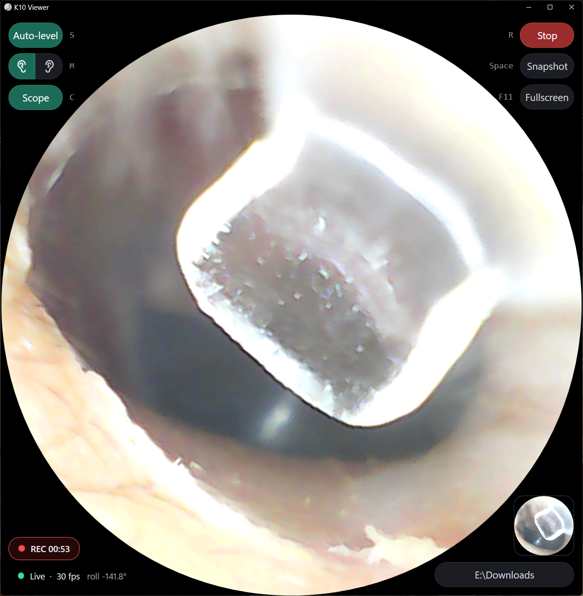
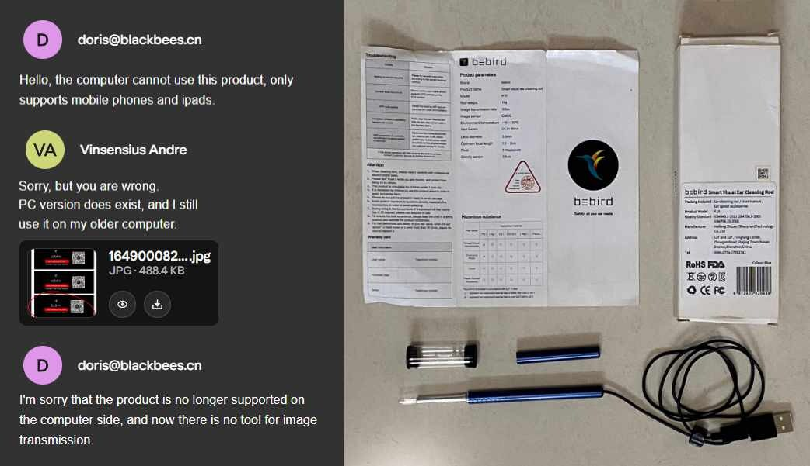

# K10 Viewer

A small Windows app for the **Bebird K10 USB otoscope**. Round scope view, auto-level using the wand's built-in gyro, photos and video recording.

> **Unofficial.** Not made by, affiliated with, endorsed by or supported by Bebird. "Bebird" is their name; it is used
> here only to say which device this works with. It is built for the K10 only and has not been tried on other models.

## Why this exists

Long story short: I bought the Bebird K10 because it's USB, it's reliable, there's no battery to slowly die, and it just works on a Windows PC. Perfect for computer nerds like us. Then Bebird took their PC software off their server.

The download link for Windows system (https://www.bebirdmall.com/pages/bebird-app-download) now goes nowhere. The K10 itself still works (detected as a webcam), but the part that keeps the picture upright (it has a tilt sensor in the wand) lived in that software. Without it, it is basically unusable. Perfectly good hardware, turned into e-waste by a deleted download. So here we are.

This is a from-scratch replacement, written by watching how the device talks to Windows. No Bebird code or files were used.

## Features

- Round scope view as big as the window allows, with **auto-level** from the gyro
- Normal / mirrored view (for the other ear), round mask on/off
- **Photos** (PNG) and **video recording** (MP4)
- Thumbnail of your latest capture, click it to open the folder
- Pick the save folder right in the window
- Buttons scale with the window (fine on 4K), shortcut keys are shown next to every button
- Warns you if a USB 2 port, hub or extension cable is slowing the picture down

## Known limitations

- **If you unplug the K10 while the app is open, the app tells you and closes itself.** Plug it back in and start the
  app again. (Restarting the camera inside the same app run hangs inside Windows, so a fresh start is the reliable way.)
- **After the app has read the tilt sensor, the K10 will not start video again until it is unplugged and plugged back
  in.** In normal use (plug in, use, close, unplug) you never notice. If you close the app and reopen it without
  unplugging, it shows "Unplug and replug your K10" and starts by itself when you do.

## Files and logs

- Settings: `%LOCALAPPDATA%\BebirdScope\settings.json`
- Log (useful for bug reports): `%LOCALAPPDATA%\BebirdScope\log.txt`

## Building

`powershell -ExecutionPolicy Bypass -File build-release.ps1` builds `dist\K10Viewer.exe`. It uses a private .NET 8 SDK in
`.tools\` (downloaded automatically if missing, about 290 MB, only needed for building). Source is in `BebirdScope\`
(WPF, .NET 8, DirectShow via the DirectShowLib package, Windows' built-in H.264 encoder for video).

Developer switches: `K10Viewer.exe --demo` shows a test pattern without a camera (`--demo-slow` for the slow-picture
warning, `--demo-autorecord` for a recording test); `--selftest ...` runs headless camera experiments (`SelfTest.cs`).

## License

[MIT](LICENSE): use it for whatever you like, just keep the copyright notice and don't claim you wrote it.
